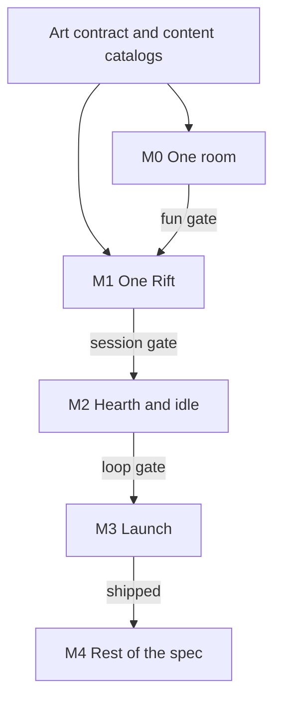

# Hearthdelve full execution plan

The spec’s roadmap now uses this plan’s milestones (One room, One Rift, Hearth and idle, Launch content) and carries a text version under its diagram so exports keep it. The sequence: four milestones, each blocked by a gate; the first gate is whether auto-combat is fun to watch; 16×16 Kenney CC0 packs as the base art from the first commit, with commissioned 16×16 art filling only the gaps after the fun gate; Glyphs, Seasons, companion Expeditions, full friendship threads, advanced Tactics, the Inn card game, expansions, the supporter pack, and iPad landscape after launch. This plan builds the entire spec in that order. No calendar dates until M0 shows how fast a room, a mob, and a Relic actually get made.

Local precedent to copy for tooling, and to deliberately not copy for the sim: [EchoShafts](EchoShafts/README.md) is a Swift package (`EchoSim`) plus an XcodeGen iOS app that draws the sim in SpriteKit. Hearthdelve uses that split and a stricter one on top: the renderer only reads snapshots, and entities are structs in arrays, because offline Expeditions, 4× speed, Lantern Mode, and [HearthSimCLI](Hearthdelve/Hearthdelve%20%E2%80%94%20Game%20Design%20Spec.md) all depend on the sim having no SpriteKit.

## Source of truth, inputs, and when to stop

**Two documents, one precedence rule.** The game design spec lives at `Hearthdelve/Hearthdelve — Game Design Spec.md`, exported from Claude Docs. The export must be from 2026-10-27 or later; it is if it contains the sections “Settings and quality of life”, “Bestiary cards”, and “Art sources (Kenney CC0)”. If any is missing, stop and ask Jacob for a fresh export before writing code. The spec wins on game rules, content, and numbers (stats, tables, defaults, cue lists, the event catalog, achievements). This plan wins on build order, architecture, tooling, and tests. If they disagree, stop and flag it; do not pick one silently. Spec diagrams may not survive export; every one has a text equivalent nearby (the roadmap’s text version, the core loops prose, the Balance math formulas).

**Numbers neither document fixes** (the hero XP curve, Paragon XP base, gold and material costs, building upgrade costs, re-roll base costs, drop-table weights beyond those listed) go in one `Content/tuning.json`, never in code. Propose starting values, then tune them in HearthSimCLI against the spec’s targets: first Unique within 30 minutes, an upgrade every 2 Rifts through Depth 50, Depth 25 / 50 / 100 / 150 at about 2 / 10 / 40 / 120 hours, Charm Rank II and III at about 3 and 15 hours.

**Content authoring rules** for the catalogs the spec only samples (15 mob families, 15 Guardians, 24 more Relics, 18 more Charms, 59 more Uniques, 5 more sets, 4 more Rift modifiers, the rest of the Glyphs):
- Build mob families around the 8 Kenney creatures first, then fill the gaps; each family covers 4 of the spec’s 5 roles (fodder, brute, ranged, caster, swarmer). Never use the 12 Wanderer sprites as enemies.
- Relics: 5 per tag (Fire, Frost, Nature, Radiant, Shadow, untyped), and each tag offers damage, control, and defense options.
- Every Unique signature changes how something plays, written only with existing opcodes and hooks. If a signature needs a new opcode, add it to HearthCore with a test; never special-case one item.
- Names are short, cozy-creepy, and free of real-world IP. All player-facing text goes in the String Catalog (English at launch).
- New rows pass the balance smoke (Depths 1, 25, 50) before merge.

**Inputs only Jacob provides.** Ask; never invent or create these:
- Apple team and bundle id; the App Store Connect app record; the $7.99 non-consumable product id; the Game Center leaderboard and achievement ids (created in App Store Connect before the TestFlight that uses them).
- Firebase project and `GoogleService-Info.plist` (kept out of git, injected locally and in CI); the CloudKit container id.
- The Kenney All-in-1 bundle path on the Mac; the three paid audio packs, bought before M2; the gap-commission artist.
- The privacy policy URL (before external TestFlight) and the CI choice (default: GitHub Actions on a macOS runner).

**Stop and ask** when the spec and plan disagree, when a needed value is a price or legal text, or before anything that touches accounts, purchases, App Store Connect, or a release.



## Repo and modules

Create the XcodeGen app and Swift packages inside [Hearthdelve](Hearthdelve). Swift 6, strict concurrency, iOS 18, portrait iPhone. iPad and Mac get the portrait layout for free and wait on landscape until M4. Personal team, same as Echo Shafts. Git remote, when asked, is `jacobrozell` via `git@github.com-personal`.

```text
Hearthdelve/
  project.yml
  App/                          lifecycle, SpriteView, StoreKit, Game Center, Firebase init
  Packages/HearthCore/          RNG, generation, combat, tactics, loot, formulas. Foundation only
  Packages/HearthContent/       JSON catalogs decoded into Core types
  Packages/HearthRender/        SpriteKit scenes, pools, interpolation. Reads snapshots
  Packages/HearthUI/            SwiftUI screens
  Packages/HearthPersistence/   save, migrations, iCloud
  Packages/HearthTelemetry/     event router + sink protocol. No Firebase import; Core never imports Firebase
  Packages/HearthAudio/         AVAudioEngine buses, cue playback from GameEvents, crossfades, voice limits, haptics
  Packages/HearthSimCLI/        macOS tool: thousands of Rifts, seed replay
  Content/                      the JSON the Content package bundles
  Art/                          atlases named by the contract
  docs/art/ docs/balance/ ongoing/
```

Dependency direction is one-way: Content, Persistence, Telemetry, Audio, Render, and UI depend on Core. Render never writes game state. The app target is the only place Firebase, CloudKit, Game Center, and StoreKit are linked. HearthTelemetry defines a `TelemetrySink` protocol and does the routing; the Firebase Analytics and Crashlytics sinks are small types in the app target that conform to it. Tests and HearthSimCLI register no sinks, or a recording sink.

## Rules that apply from the first commit

These are expensive to retrofit, so they land in M0 even when only a slice of the game uses them.

**Snapshots.** `SimActor` owns the world. Each 20 Hz tick publishes a `Sendable` snapshot: entity poses, anim ids, HP, Souls, Lantern, telegraph polygons, floating combat text. SpriteKit interpolates the last two snapshots at display rate. Live input is a command queue (`fireRelic`, `drinkPotion`, `setSpeed`, `pause`), applied at the next tick. Speed 2× and 4× means more ticks per frame. Lantern Mode means ticks with the scene paused and the screen dimmed.

**Deterministic RNG.** SplitMix64 expands a 64-bit seed into four xoshiro256** streams: layout, population, combat, loot. Golden-seed tests hash layout and kill order. Tweaking loot must not move a room. No `pow`, `exp`, `log`, or other libm transcendentals inside the tick: their last bits can change between OS releases and silently break replay. The golden-seed suite runs on macOS, on the newest iOS, and on the oldest supported iOS (iOS 18) in CI.

**Data-oriented entities.** Struct arrays per component, spatial hash for queries, cap around 150 live entities. Hero pathing is A* on the room grid, replanned at most every 10 ticks (0.5 s). Mobs share one flow field toward the hero, rebuilt once per tick. Do not port Echo Shafts’ class-per-entity model.

**Effect opcodes, not one Swift type per Relic.** A Relic, Unique signature, elite affix, and shrine are data: damage (coefficient, element, radius, duration), zone, shield, heal, root, dash, summon, taunt, stun. Unique signatures are hooks (`onStun`, `onHit`, `onKill`) that enqueue another opcode. Thirty Relics and sixty Uniques then become JSON rows. HearthSimCLI can run them with no art.

**Numbers.** Stats are `Double`. Scaling curves (1.12^d, 1.10^i, 1.08^d, 1.08^i, B(d)) are lookup tables indexed by integer Depth or item level, built by repeated multiplication from index 0 (plain IEEE multiplies, identical on every device), extended on demand as players go deeper, and covered by a test that pins a few entries bit-for-bit. Power-versus-Threat comparisons for UI predictions may use log space; nothing inside the tick does. Display suffixes are K, M, B, T, then aa, ab, ac. Formulas from the spec are pure functions with unit tests before anyone tunes them by feel:

- Enemy HP `HP0 * 1.12^d`, enemy damage `Dmg0 * 1.08^d`
- Weapon and Relic Power `P0 * 1.10^(i-10)`, hero HP from armor `H0 * 1.08^(i-10)`, item level `i = depth + 10`
- Outgoing `D = P * S * (1 + sum A) * product X * C`
- Incoming armor and resist use `Armor / (Armor + 50L)` and `Res / (Res + 5L)`, `L = depth + 60`, dodge rolled first
- Required build multiplier `B(d) ≈ 1.018^d`

**Save shape reserved early.** Schema version 1 already has empty slots for Glyph sockets, banked Glyph Points, Reliquary signatures, companion Expeditions, the Bestiary (card id → copies, foil flag, per-creature pity counters), Inn card-game records, the biome-table version, and season id, so neither M3 nor M4 migrates a blob that cannot grow. Glyphs stay unwired until M4; hero levels bank Glyph Points silently and the UI reveals them all at once when Glyphs ship. Uniques are never auto-salvaged before their Codex entry exists.

**Depth and biome indexing, locked now as data.** Depth-to-biome comes from a versioned rotation table in Content, not a hard-coded formula. Version 1 is 10-Depth bands cycling 1–10 Mossy Cellars, 11–20 Fungal Hollows, 21–30 Drowned Library, 31–40 Ember Forges, 41–50 Starless Vault, then the same cycle as Echoes from 51. An expansion ships a new table version that takes effect only from a stated Depth band upward (for example, the first expansion changes the rotation from Depth 201), so no Depth below it ever changes biome. Saves, Rift results, and leaderboard loadout snapshots record the table version. The free unlock stops when a Deep Rift would advance past Depth 25. The player finishes both of the first two biomes and sees the Library long enough for Depth 25 to be the conversion moment the funnel describes.

**Difficulty bands, proposed and then tuned in the CLI.** Compute the loadout’s effective build multiplier: its expected damage at Depth d divided by the expected damage of a par loadout (par item level, no Uniques, sets, Charms, or Paragon) at the same Depth. Compare that ratio with `B(d)`, so both sides are dimensionless multipliers. Easy at or above 1.5×, Fair from 1.0× to 1.5×, Hard from 0.7× to 1.0×, Deadly below 0.7×. Expeditions may only be sent to Easy or Fair. If a return-time check says the Depth is harder than predicted, the Expedition ends early and keeps everything earned.

## Parallel track: what to make before the systems need it

Kenney’s CC0 packs are the base art from the first commit, so the fun gate is judged on real art instead of placeholders. Commissioned art fills only the gaps Kenney leaves (most creatures, Guardians, Wardens, Relic and Charm icons, the moth), at 16×16 in Kenney’s style. Commissioning before the fun gate would still lock gap creatures to an unproven camera, so the gap list waits for it.

**Start on day one, alongside M0 code.**

- Art contract in `docs/art/contract.md`. 16×16 tiles and characters, nearest-neighbor, drawn at 2 points per art pixel (6 device pixels on 3× iPhones, 4 on 2× iPads), so about 12 tiles fit across a portrait phone. Guardians and Wardens may be 32×32 (2×2 tiles). Draw order: shadow, telegraph, floor decal, body, legs, chest, boots, helm, weapon, moth, affix icons. Facings: right only, left is a mirror (Kenney sprites face one way). Animation ids stay `idle`, `walk`, `windup`, `attack`, `hit`, `death`, but each defaults to a procedural tween in HearthRender (idle bob, walk bounce and flip, wind-up lean, attack lunge with a weapon arc, hit flash and knockback, death squash and fade); a sprite can override any id with hand-drawn frames, reserved for Guardians. Hero paper-doll layers come from Kenney Roguelike Characters (base, clothing/armor, headgear, hair, weapon, shield). Generic armor tiers are recolors; the six sets are distinct Roguelike Characters combinations plus a set tint. Elite outline is a tint plus a floating icon, not a new sprite. Echo biomes are a darker, cooler palette swap plus one new attack, same silhouettes.
- Master palette built from the Kenney packs’ own colors plus warm amber and green for the Hearth, 12-color sub-palettes per biome (offline recolor), Echo variants by a palette-swap `SKShader`, published as a GPL file the atlases and the UI both read.
- Kenney packs vendored under `Art/vendor/kenney/<pack>/` with each pack’s license file, unmodified: Tiny Dungeon, Tiny Town, Tiny Farm, Tiny Battle, Roguelike Characters Pack, Roguelike Base Pack, Roguelike Dungeon Pack, Roguelike Interior Pack, UI Pack - Pixel Adventure, UI Pixel Pack, Emote Pack, Fonts, Cursor Pixel Pack, Light Masks. A build script recolors and packs them into contract-named atlases. `docs/art/kenney-map.json` maps every contract id to pack + sprite index (or to `gap:<id>` until commissioned art lands). Gameplay code references contract ids, never pack file names. Credit Kenney on the About screen even though CC0 doesn’t require it.
- UI skin, two layers. In-world UI (HUD, building screens, item cards, tooltips, Bestiary) uses Kenney pixel panels: UI Pack - Pixel Adventure if it is the pixel fantasy set, otherwise UI Pixel Pack. Open that folder and Fonts first; the bundle index lists them without files. System UI (Settings, purchase, bug report, Game Center, iCloud) is native SwiftUI with SF Symbols and the system font inside the same pixel frames. A Kenney pixel font only for titles, HUD numbers, and item names at whole-number scales; SF Pro Rounded with Dynamic Type for body text. Emote Pack pixel sheets for Wanderer reactions. Panels are resizable images with cap insets and `.interpolation(.none)`. Not used: UI Adventure Pack, UI Pack - Adventure, UI Pack, Game Icons (smooth vector styles).
- First art task, before M0 combat art is wired: put Tiny-series and Roguelike-series sprites side by side on a physical phone. If the two styles clash, the Roguelike series becomes the base and Tiny Dungeon only supplies recolored creatures.
- Kenney inventory, done by the local agent against the All-in-1 bundle, writes every mapping into `kenney-map.json` and every miss into the gap list. Starting notes from a first pass over Tiny Dungeon and Tiny Town (both `tilemap_packed.png` sheets are 12×11 grids of 16×16, numbered row by row as `tile_0000`–`tile_0131`):
    - **Tiny Dungeon creatures (8):** slime #108, cyclops #109, horned red crab-demon #110, bat #120, ghost #121, spider #122, brown rat #123, grey rat #124. Mimic chest #92 is the Glimmerkin (the treasure creature that flees).
    - **Tiny Dungeon humans (12):** #84–88, #96–100, #111, #112, exactly one per Wanderer. Proposed: smith #86, herbalist #112, cartographer #88, bard #85, archivist #111, relic keeper #84, chandler #100, quartermaster #87, glyphwright #97, gardener #99, trophy keeper #96, lighthouse keeper #98. The hero still comes from Roguelike Characters for the paper-doll.
    - **Weapons:** Sword #104 (broadsword #106), Hammer #117, Daggers #103, Spear #131, Wand #129 (staff #130) in Tiny Dungeon; Bow #118 and arrow #119 in Tiny Town. Crossbow, Sling, and Scythe are missing from both. Extras: cleaver #105, axes #118/#119, wooden club #107, shields #101/#102.
    - **Dungeon tiles and props:** dirt floor #0 (rubble #12, #24); sand #30, #48–53; brick walls #36–40, #57–59; raised stone block 9-slice #1–3, #13–15, #25–27; arch with steps #9 (stairs); doors #21–23, #33–35, #45–47; pit #56; pillar #6/#18; fountains dry #7/#19/#31/#43 and green-water #8/#20/#32/#44 (Drowned Library); barred window #28; red banner #29; statue niche #41 (Shrine); gravestone #65 and iron bars #76–78 (Starless Vault); table #72, stool #73, anvil #74 (Ember Forges, Blacksmith), bookcase #75 (Drowned Library, Library); barrel #82; chests #89–91; potions #113–116; vials #125–128; hazard stripes #62 and dashed marker #60 (optional telegraph overlays). #54/#55 look like a sarcophagus and a stone altar; verify.
    - **Tiny Town (Hearth):** grass #0–2, dirt path 3×3 #12–14/#24–26/#36–38, trees and forest blocks #3–11, #15–23, #27–35, red mushrooms #29 (Fungal Hollows prop), fences #44–47/#56/#58/#59/#68–71, slate roof #48–51/#60–63, tile roof #52–55/#64–67, wood walls/doors/windows #72–75/#84–87, stone walls/doors/windows #76–79/#88–91, signpost #83 (Map Room), tent #92, coin #93, beehive #94 (Garden), archery target #95 (Trophy Hall), plaza 3×3 #96–98/#108–110/#120–122, battlements #99–102, cellar hatch #103, **well #104 (the Rift entrance)**, bomb #105, log #106, cauldron #107 (Apothecary), castle gates #111–114/#123–124, arrow slit #125, tools #115–117/#127–129, buckets #130/#131.
    - **Missing from both sheets, check other packs before commissioning:** lantern, campfire, candles (the game's core light motif), water tiles, armor-slot icons (helm, chest, legs, boots), material icons (Dust, Shards, Embers), crossbow, sling, scythe, a lighthouse (try composing it from castle pieces). Look in Tiny Farm, Roguelike Characters, the Roguelike Base, Dungeon, and Interior packs, and the 1-Bit pack (recolored) first.
    - **Creature gap:** 8 Kenney creatures against about 60 launch creatures leaves roughly 50 to commission. If that is too many, launch with fewer roles per family and add the rest in content updates.
- Room format: 16×16 chunks authored in Tiled, exported to JSON with tile ids, collision, spawn rects, and a tag (`entry`, `stairs`, `arena`, `side`). The generator accepts any count, so M1 can ship 8 templates and M3 can reach 20 per biome without a code change.
- Shared VFX kit: projectile, nova, ground zone, summon, buff, dash, parameterized by element palette. Relic art is a row in that kit plus a tint. Bespoke frames are reserved for Guardians and the Unique drop sting. This stays inside the budget of 8 live emitters.
- Content catalogs as JSON, validated in CI (`hd.content` / `missing_definition` fails the build): weapon types, the 12 elite affixes with the compatibility ban list, the 7 events, a launch set of 8 Rift modifiers, 30 Relic rows, 24 Charm rows, 60 Unique rows, 6 sets, 15 mob families, 15 Guardians, 2 Wardens, 12 Wanderers, the building-unlock table (Depth → building → Wanderer whose first rescue is scripted there), and the v1 biome rotation table. Bestiary card rows are generated from the mob, Guardian, and Warden rows (id, family, role, Depth band, four edge values from role), not hand-written, so the about 77 launch cards and their foils can never drift from the creatures. M0 only loads a slice. The rest sits in the repo so writing content is not blocked on screens.
- Three reference loadouts from the spec (Ember Bruiser, Hound Warden, Glass Archer) as CLI fixtures, scaled to par item level at Depths 1, 25, 50, 100, 150, 200, and 300.
- Audio sourcing per the spec’s Audio section. Already owned (Kenney All-in-1, CC0): Interface Sounds for all UI, Impact Sounds for hits and footsteps, RPG Audio for foley, Music Jingles (Pizzicato set) for stingers. To buy: Cozy Casual Bundle Vol. 1 (Hearth music, $29.97), RPG Music Pack: Dungeon Themes (biome and Guardian music, $12.99), Fantasy Ambiences (biome beds, campfire, rain, $9). Free: a Sonniss GDC bundle for Relic casts by element. Kenney Retro Sounds stay out (chiptune fights the acoustic score); Kenney Music Loops are placeholders only. Keep every license file in `Audio/licenses/` and read each paid pack’s actual license before shipping. M0 uses Kenney SFX only; music and beds are wired in M2 (Hearth) and finished in M3.
- Audio build step: convert source OGG/WAV to CAF (short SFX) and AAC .m4a at about 160 kbps (music, beds), normalize loudness (music around −16 LUFS), and stay inside a 40 MB audio budget. `docs/audio/cues.json` maps every cue id from the spec’s cue list to a file, bus, priority, and pitch rule, the same way `kenney-map.json` does for art.

**Style key during M0, after the first on-device screenshot.** A Kenney-built frame (hero paper-doll, a Mossy room, one fodder, one telegraph shape) at the real scale on an iPhone-mini-sized device, plus one commissioned test sprite: the lantern moth. This becomes the gap artist’s brief, so commissioned sprites match Kenney’s outlines, shading, and proportions.

**Gap commission starts the day the M0 gate passes**, runs through M1, and covers only what `kenney-map.json` marks as `gap:`. Production order, because these are the long poles:

1. Moth, Mossy biome props (fungi, roots), any Mossy creatures Kenney lacks, 1 Mossy Guardian (32×32).
2. Hearth: assemble tier-1 buildings from Tiny Town and the Roguelike Base Pack in Tiled; commission nothing unless a building has no Kenney match.
3. Remaining biomes in cycle order: biome props, the creatures Kenney lacks, 3 Guardians each.
4. Two Warden kits (Depth 50 and Depth 100), 32×32 with hand-drawn frames. Later milestone bosses reuse a kit until an expansion.
5. Weapon layers for any of the 9 weapon types Roguelike Characters lacks.
6. Building tiers 2–5 as larger multi-tile compositions of Kenney pieces, not new sprites (do not block the Hearth scene on tier 5).
7. Icons: 30 Relics, 24 Charms, 12 affixes, armor slots (helm, chest, legs, boots), materials (Dust, Shards, Embers). Item icons and UI come from Tiny Dungeon, Tiny Town, the Roguelike Base Pack, and the chosen UI pack.
8. Bestiary card kit: the frame is a 9-slice panel from the chosen UI pack; commission only the foil overlay and three launch card backs. Card faces reuse the creature’s sprite, so no per-card art is commissioned.

Expected gap volume, to confirm once the bundle is inventoried: about 50 creatures, 17 bosses, about 70 icons, 3 weapon types (crossbow, sling, scythe), the lantern, campfire, and candle set, water tiles, biome props, and the moth.

Room templates are the hidden content cost: 5 biomes × 20 chunks. A starter kit of corridor, small room, large room, side room, and arena gets duplicated. Target 8 templates for the M1 biome, 20 by M3.

## M0 — Is it fun to watch?

One hand-built room. No generator, no loot, no Hearth, no save. The question is the combat.

Build in HearthCore:

- Tick loop, four RNG streams, snapshot publication, command queue.
- Hero: nearest target, ranged beyond 3 tiles, melee inside, A* plus flow field.
- Sword and bow with their innate patterns (every 3rd melee cleaves, every 3rd shot charged).
- Ember Flask and Lantern Ward through the opcode runner. Souls: 1 per kill, +5 per elite, cap 100, slow regen.
- Three Tactics slots, top to bottom, else the generator attack. Prefill: potion under 35% HP, Lantern Ward when an elite is close, Ember Flask when 3 enemies are in range.
- Fodder, a Brute with a 0.6 s slam telegraph, a Ranged that keeps distance. Telegraph is a filled ground shape with a bright edge.
- Damage formulas with placeholder `P0` and `HP0`, logged so the CLI can sweep them.

Build in HearthRender and a thin app shell:

- `SKTileMapNode` floor, pooled mobs and projectiles, additive glow sprites (no `SKLightNode`), interpolated motion.
- Bottom thumb zone: two Relic buttons with cooldown rings, potion, 1×/2×/4×, pause. HP and Souls above that. Nothing tappable at the top.
- Kenney atlases only: a Tiny Dungeon or Roguelike room, the Roguelike Characters hero, and Tiny Dungeon creatures for the three mob types, animated by the procedural tweens.

Build in HearthSimCLI:

- Replay a seed to a tick and print time-to-kill. A unit test asserts two processes produce the same hash.

**Fun gate, on a physical iPhone.** Iterate on the simulator at iPhone mini size, but judge the gate on a real device (iPhone 13-class or the smallest phone available), because readability at true size and brightness, thumb reach, and frame rate cannot be judged in the simulator. Spend five minutes watching, the length of a Rift. Pass only if fodder dies in a hit or two, the slam is readable, Relic taps change the fight, and the hero’s movement reads as a decision. Also require a golden seed match and a frame rate that holds on that device. If it fails, retune coefficients, telegraph timing, and camera scale before any content. Record how long the room, the three mobs, and the two Relics took; that number time-boxes M1.

## M1 — One complete Rift

Kenney art throughout, plus any Mossy gap sprites that are ready. One biome, one session, loot that sticks.

Generation, four passes, Mossy Cellars only, about 8 room templates: tree of 4–8 rooms, 0–2 loops, threat budget, packs, at most one side room. Entry, stairs, and a Guardian arena on the last floor. One to three floors. Rift meter: fodder 1%, elites 4–6%, rare packs 8–10%. Stairs when the floor is roughly clear; the hero takes them if the meter is not full. At 100% the Guardian spawns on the hero. Guardian HP starts at 120× fodder HP, two telegraphed mechanics, enrage at 30% HP.

Gate screen: Depth, Delve versus Deep Rift, biome, predicted difficulty. Delve has no Lantern. Deep Rift Lantern is a 6-minute burn; remaining fraction sets the Depth jump at +3 / +2 / +1 / +0. Running out still drops loot. Death copies the same soft return: gear kept, Deep Rift awards +0. Copy the line “You wake by the hearth. Everything you found came home with you.” The Hearth here can be a single SwiftUI room with a well; the pan-able village is M2.

Loot slice: item level = Depth + 10, Common / Rare / Unique, a short affix pool, three Uniques whose signatures use opcodes (include Cinderfang), upgrade score as two arrows (damage and toughness versus the equipped piece). Bag of 40. Loadout slots that exist at level 1: melee, ranged, four armor, first Relic. Weapon auto-switch as in the spec. Pity counter (40 Rares upgrade the next) is in the roller even if it rarely fires.

Persistence: one JSON save, schema version, last three copies, autosave on Rift end and background. No iCloud yet.

CLI: the three reference loadouts at a comfortable Mossy Depth clear in 3–5 minutes in a Delve, and a Deep Rift at the edge of Fair lands in 6–8 minutes with Guardian time-to-kill 30–60 seconds.

**Session gate.** A coffee-break Rift from Gate to result, death keeps the drop, the same seed replays, and the first Unique is reachable inside half an hour of the CLI’s early-game loadout.

## M2 — The three session shapes

Systems complete, content still thin (Mossy plus Fungal). Commissioned Mossy art swaps in when it passes the readability rules. This milestone is the game loop, not the catalog.

**Hearth scene.** One hand-built village, about two phone screens wide, pan, tap a building to open its screen. Day and night from the device clock; lanterns at dusk. Weather is cosmetic. Tier-1 sprites. The moth is in the village and in the Rift, picks up loot with a larger radius, and glows as the Lantern falls. Game Center access point is here only.

**Buildings that the loops need, tier 1 unless noted.**

- Blacksmith: salvage (Dust / Shards / Embers + Codex), re-roll one affix with doubling cost, raise item level up to best Depth, craft a Rare, transmute a Unique.
- Library: Tactics slots start at 3 and this milestone opens the path toward 10. Condition library without AND/OR or hold-until: HP, enemy count, target type, affix present, Souls, buff, cooldown ready, Lantern, meter.
- Map Room: Expeditions, 8-hour cap.
- Apothecary: one potion, charges and cooldown.
- Inn: rescued Wanderers walk, sit, and comment. No side Expeditions yet.
- Stash House: 100 slots.
- Reliquary: salvage records a signature; one equip slot (weapon, armor, or Relic — the first unlock).
- Chandlery: a single Lantern-efficiency upgrade so the soft timer is already a build lever.

Garden, Trophy Hall, Lighthouse, and Glyphwright exist on the map as tier-0 shells so the village composition is final. Their systems finish in M3 (Glyphwright in M4).

**Idle.** When the player sets an Expedition Depth or changes the loadout, run 3 headless Rifts in the foreground (well under a second) and store the mean clear time in the save. Going to the background only writes a timestamp, so force-quits, crashes, and iOS’s short background window never lose an Expedition. On return compute `floor(min(away, cap) / mean) * 0.6` Rifts of batched loot. Wall clock, backwards jumps count as zero, never a wipe to zero. Return screen lists Rifts, XP, materials, best items, Charm rank-ups, after loot rules have auto-salvaged. Auto-Delve repeats a chosen Depth at up to 4× with Lantern Mode. Deep Rifts never automate. Opt-in notification when the Expedition cap is hit. No nag.

**Meta slice.** Hero levels 1–100 grant HP and bank one Glyph Point silently (no UI until Glyphs ship in M4, when the banked total appears at once). Relic slots at 1, 5, and 10. Charm slots at 3, 15, and 30. Charm XP while equipped; Expedition time counts at 50%; Rank II and III use the 3-hour and 15-hour targets. After 100, XP becomes Paragon: Core board (+0.5% Power, uncapped) plus Offense, Defense, and Utility with nodes capped at 50, free respec. Four saved loadouts. Loot rules: rarity, score, “not an upgrade for a saved loadout.”

**Onboarding.** First ten minutes: one Delve with Sword and Bow, then the first Relic, then three prefilled Tactics the player can read. Each later system gets two or three lines from the Wanderer who runs it, at the unlock.

**Settings and quality of life, core set.** Settings screen from the Hearth gear and the Rift pause menu (Audio and Display only there), with the spec’s defaults. Storage split: device preferences (audio, display, haptics, battery, notifications) in `UserDefaults`; gameplay preferences (loot rules, auto-equip, Tactics) in the save so they sync. This milestone ships: music, ambience, SFX, and UI on/off plus sliders; “Play music over my audio” (off); haptics level; remembered Rift speed; confirm before salvaging Uniques and Heirlooms; item lock/favorite, “New” badges, bag sort and filter, salvage preview and undo; Equip Best per saved loadout with a preview; result-screen Retry and Push next Depth; Repeat last Delve; Auto-Delve stop conditions (N runs, bag full, Unique dropped); Hearth building badges and Collect All; auto-pause on interruption and exact resume.

**Wanderer roster, one per building, written in this milestone.** Smith, herbalist, cartographer, bard, archivist, relic keeper, chandler, quartermaster, glyphwright, gardener, trophy keeper, lighthouse keeper. Each Wanderer’s first rescue is a scripted Rift event on the first clear of the Depth in the spec’s building table (Blacksmith at onboarding, then Depths 2, 3, 5, 8, 10, 12, 15, 20, 25, 40, 50), so they are home before their building’s system appears and can introduce it; the smith is rescued in the onboarding Delve. The random Lost Wanderer event only brings later visits and gifts. M2 plays only the first friendship step. The other steps are M4.

**Loop gate.** Check-in under two minutes (collect, equip, resend). Coffee break is one or two Rifts. An evening session can re-roll, edit Tactics, and push. CLI: first Unique inside 30 minutes, an upgrade at least every two Rifts through Depth 50, Depth 25 around two hours for the reference build, offline calc under 0.5 seconds, 1,000 headless Rifts under 10 seconds on an M-series Mac.

## M3 — Launch content and the ship

This is the MVP in the spec: every system a launch player can touch, none of the cut list.

**Content.** Five biomes, 20 templates each, Echo palette and one new attack per family after Depth 50. Affix schedule: 1 / 2 / 3 / 4 affixes at Depths 1, 25, 50, and 100, with the compatibility table enforced. Heirlooms at 50, Rift modifiers at 75, Starforged at 150 (1% of Heirlooms, all affixes maxed, signature +20%). Warden at every 50th Depth using the two bespoke kits, guaranteed Unique. All 12 elite affixes, all 7 events, 8 modifiers (Brittle, Swarm, Fog, Bounty, plus four more in the same budget). Thirty Relics across Fire, Frost, Nature, Radiant, Shadow, and untyped. Twenty-four Charms. Sixty Uniques (20 weapons, 25 armor, 15 Relics) and six 4-piece sets, including Lamplighter’s Vigil. Codex bonus every 10 entries. Depth-milestone rewards every 10 Depths: title, decor, or a one-time material cache. All 12 buildings to tier 5, including stash to 400, Expedition cap 8 → 12 → 16 → 24, Reliquary slots 1 → 3, potion upgrades, Trophy Hall family bonus, Lighthouse skyline. Twelve Wanderers rescues and the first friendship step only. Decor spots filled from milestones, gifts, garden flowers, and trophies, with no stat on decor.

**Bestiary cards.** A card roll on every kill: 1% until the card is owned, then 0.1%; elites 5×, rare packs 10×; a Guardian’s card guaranteed on its first kill, then 5%; per-creature pity guarantees the card after 300 kills without it. Echo variants roll foils. Expeditions roll cards inside their batched loot at the same rates. Duplicates raise stars (1 / 3 / 10 copies), 3 stars unlocks the lore entry, extra copies become Wanderer gifts. Every 10 cards grants decor or a card back. The Trophy Hall family bonus requires that family’s Guardian card. Cards never add stats directly and are never sold. UI is a Bestiary tab inside the Codex plus a short flip reveal on drop, quieter than a Unique.

**Rift HUD, finished.** Relic buttons, potion, speed, pause; HP, Souls, Lantern arc tied to the moth; top shows meter, Depth, and floor. Damage numbers default off above Depth 50. Left-handed layout mirrors the bottom bar. Reduce flashing, no screen shake, compact numbers, larger telegraphs, haptic level. Dynamic Type and VoiceOver on every SwiftUI control and item. Affixes use icon, shape, and color.

**Settings and quality of life, complete.** The rest of the spec’s Settings table: auto-equip clear upgrades (off), pause on Guardian spawn, damage-number modes, Lantern as a percentage, colorblind palettes, frame-rate cap (30 fps in Low Power Mode), Lantern Mode after inactivity, keep-awake while charging, opt-in notifications asked once after the first Expedition, iCloud toggle, save export and import, restore purchase, analytics toggle, bug report, reset progress (two confirmations plus typing RESET), and About with credits for Kenney, the music and ambience packs, and Sonniss. Quality of life: Training Yard dummy at the Trophy Hall reporting DPS over 30 seconds, Tactics templates, copy rules between loadouts, per-rule fire counts from the last Rift, long-press explanations for every stat and keyword, Codex search, tutorial replay from the Codex (skipped on iCloud restore), 44-point minimum touch targets. Every change logs `settings_change`.

**Platform.** CloudKit private-database save blob; on conflict show both saves (best Depth, Paragon, last played) and let the player pick. Game Center leaderboard for best Deep Rift Depth plus a loadout snapshot. Local ghost of meter-versus-Lantern on the Gate. Achievements tracked in the save first, reported when online, re-reported after an iCloud restore. Launch set is the 39 achievements whose conditions exist at launch, 900 points, including the Bestiary chase achievement (`hd.chase.bestiary`, 20 points). `hd.chase.glyph_master` and its 20 points ship in M4, leaving 80 points of the 1,000-point cap for expansions and Seasons. IDs follow `hd.depth.100` and are created in App Store Connect before the first TestFlight that should unlock them. Counter achievements report percent. Privacy: a `PrivacyInfo.xcprivacy` manifest declaring required-reason APIs (UserDefaults, file timestamps, system boot time if used) alongside the Firebase SDKs’ own manifests, and an App Privacy label of Diagnostics and Usage Data, not linked to identity, not used for tracking.

**Telemetry.** HearthTelemetry subscribes to `GameEvent` and fans out to Firebase Analytics, Crashlytics breadcrumbs and custom keys, and a 500-line on-device ring buffer. Implement the catalog in the spec (app, onboarding, rift, loot including `card_drop`, build, hearth, idle, progress, store, `perf_rift` at 10%). Events share only `session_id`; slow-changing context (`schema_v`, `content_v`, `sim_v`, `best_depth`, `paragon`, `hero_level`) is set as Firebase user properties when it changes, and Firebase records app version itself. Rift events add `rift_id`, seed, depth, mode, and loadout hash, which keeps `rift_end` at exactly 15 parameters. No per-hit analytics. Combat breadcrumbs locally at 1 Hz. A unit test fails CI if a case is unmapped, the name exceeds 40 characters, or a payload exceeds 15 parameters. Non-fatal domains as specified (`hd.save`, `hd.sync`, `hd.sim`, `hd.content`, `hd.offline`, `hd.store`, `hd.gc`, `hd.metrickit`). MetricKit hangs forwarded as non-fatals. Settings toggle stops collection immediately. No AdSupport, no ATT. Crashlytics user id is a random install UUID. Debug and TestFlight builds get the seed/tick overlay. Bug report share sheet attaches breadcrumbs and the save.

**Monetization.** StoreKit 2, one non-consumable, $7.99, named as the full unlock. Free through Depth 25. No ads, energy, keys, loot boxes, or Power for sale. `unlock_view` and `unlock_purchase` events feed the funnel install → first Rift → first Unique → Depth 10 → Depth 25 → purchase.

**Audio and juice.** HearthAudio subscribes to `GameEvent` like telemetry. `AVAudioSession` category `.ambient`, so the player’s own music or podcast keeps playing and the silent switch is respected; if other audio is playing, game music stays silent and SFX still play. Four buses (music, ambience, SFX, UI) with Settings sliders. At most 12 SFX voices, priority UI > loot > Relics > hits, an identical cue at most once per 50 ms; hits thin out at 2×/4× and only loot stings play in Lantern Mode. Music crossfades for 2 s between Hearth and biome, cuts to the Guardian track at spawn, and always returns to the Hearth theme. Biome sound map and cue list as in the spec: Hearth acoustic bed with a fire crackle that follows the clock, one track and one ambience bed per biome (Echo variants use an alternate variation and a bed pitched down a semitone), one Guardian track, rarity pitch ladder, Unique sting, Lantern hum. Core Haptics on pickups and Uniques, silent on ordinary hits. Commissioned gap sprites replace their `gap:` entries in `kenney-map.json` in place.

**Ship gate.** Balance CLI report checked for the tuning table (Depth 25 / 50 / 100 / 150 near 2 / 10 / 40 / 120 hours on the reference builds; elite packs 8–15 seconds; fodder 1–2 hits at par). Frame rate 60 on iPhone 13-class, memory under 400 MB, install under 300 MB. Crash-free target 99.5% once TestFlight has volume. Then run the personal pre-submit review (Bugbot, tests, and the store-policy lane) and file `docs/release` plus a `workspace/projects/hearthdelve.md` status row when the version actually moves.

## M4 — The rest of the spec

Only after the launch gate. Each item is already reserved in data or schema.

- **Glyphs.** Learn-once from Guardians and the Lectern. Sockets 1 / 2 / 2. Ranks I–III cost 1 / 2 / 3 Glyph Points, refund on remove. Glyphwright raises max rank and can add the Common socket. Ship `hd.chase.glyph_master` when every launch Glyph can reach Rank III. Banked Glyph Points appear at once on first unlock. Kindle, Ricochet, Thrift, Bulwark, and Harvest are the first five; the rest of the launch set is authored to the same opcode list.
- **Advanced Tactics.** AND/OR and hold-until, sold by Library tiers that M3 left dormant.
- **Companion Expeditions.** Up to three Wanderers, 1–4 hours, materials, Glyphs, and decor. Never gear. Opt-in “companion back” notification. Inn upgrades 1 → 3 slots.
- **Friendship.** The remaining two steps per Wanderer, gated by Depth milestones: a few lines and a gift. No romance, no gifting minigame.
- **Inn card game.** Played at the Inn against Wanderers with 5-card hands from the Bestiary: 3×3 board, four edge values, a placed card captures adjacent enemy cards with a lower touching edge, most cards owned at the end wins. Biome boards give that biome’s cards +1 on every edge. Each Wanderer has a themed deck and three difficulty tiers; the AI is deterministic and lives in HearthCore so HearthSimCLI can test it. About 3 minutes a match. Rewards are decor, card backs, titles, and friendship progress, never Power or gear. No PvP, deck-building beyond picking 5, or rule variants at first.
- **Echo Seasons.** Opt-in new hero, one seasonal rule, separate leaderboard, rewards limited to cosmetics, decor, and one Codex entry that returns to the main hero. The main hero is never reset.
- **Supporter pack.** Decor and hero cosmetics only.
- **First expansion.** A new biome pair added through a new biome-table version that takes effect only from a stated Depth band upward, with families, Guardians, Uniques, and a Wanderer. Depth stays one ladder. Price band $2.99–$4.99 when it is real.
- **iPad landscape.** A second layout pass. Portrait remains the phone default.

## Standing checks

- Core tests: formulas and curve tables (pinned entries), Tactics first-match, loot shares, pity (Rare-to-Unique and Bestiary cards), card drop odds, Lantern jumps, clock clamp, offline rift count, effect opcodes, difficulty bands.
- Content tests: every id resolves, banned affix pairs never roll, biome tables cover every role, every creature has a generated card, every building has a Wanderer and an unlock Depth, biome table versions never change a Depth below their start band.
- Golden seeds: five seeds, stable across macOS, the newest iOS, and the oldest supported iOS.
- Telemetry: every `GameEvent` case mapped, names at most 40 characters, at most 15 parameters per event.
- Balance smoke on every content change at Depths 1, 25, and 50; the full 0–300 sweep is local before a content drop.
- Sim invariants (`NaN`, negative HP, tick overrun) log `hd.sim` with seed and tick, then correct.
- One screen, one job. A system appears in the UI at the level that unlocks it.

## What the first implementation week actually opens

M0 code and the parallel track together, nothing from M1’s generator:

1. XcodeGen project, the eight packages, CLI that boots an empty tick loop, one golden-seed test.
2. Art contract, palette, vendored Kenney packs with `kenney-map.json`, the side-by-side style check on a phone, Tiled export, JSON schema, and the validator.
3. Formulas and the three reference loadouts in the CLI, printing `B(d)` from 0 to 300.
4. The one-room combat slice, then the style-key screenshot.

The fun gate is the only thing allowed to start M1.
