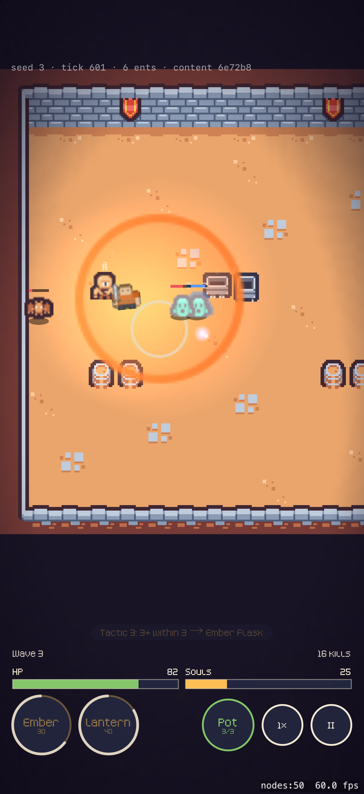

# M0 fun gate

The M0 build is done. The gate is Jacob's call on a physical iPhone, and it is the only thing allowed to start M1.

## Run it

1. Run `xcodegen`, open `Hearthdelve.xcodeproj`, and run the `Hearthdelve` scheme on the smallest iPhone available (team 7JT2JB89AV).
2. Optional: pick a seed with Edit Scheme > Arguments > `-seed 3`. The default seed is 1, and each new run counts up from it.
3. Watch at least five minutes, about the length of a Rift. A dead hero starts a new run after 5 seconds.

## Checklist

- [ ] Fodder (slimes, bats) die in one or two sword hits.
- [ ] The Cyclops slam is readable: the orange disc fills toward the hit, and you can tell whether the hero got out.
- [ ] Tapping Ember Flask or Lantern Ward changes the fight. Try holding both until a champion wave (every third wave has outlined elites).
- [ ] Hero movement reads as a decision: it kites with the bow, closes in with the sword, and steps out of telegraphs.
- [ ] The Tactics readout ("Tactic 2: …") makes it clear why a Relic fired by itself.
- [ ] Readable at true size and brightness: hero against mobs, enemy bolts, HP, and Souls.
- [ ] Both thumb buttons are easy to reach one-handed.
- [ ] Frame rate holds at 60 on the device (Debug builds show FPS in the corner).
- [ ] Golden seed match:
  1. Get a run the app saved: Files > Hearthdelve > `recordings/`. Runs save automatically on death; "Save this run" also saves one.
  2. Copy it to the Mac.
  3. Run `swift run --package-path Packages/HearthSimCLI HearthSimCLI replay --recording run-N-T.json`. It must print `match`.
- [ ] The death screen line reads right: "You wake by the hearth. Everything you found came home with you."

## If it fails

Retune before adding any content. Everything is in `Content/tuning.json` → `room`, plus the Relic and mob rows. The values to reach for are reaction time, attack cadence, telegraph seconds, slam radius, elite HP, and Relic coefficients. Camera scale is `RiftScene.pixel` (points per art pixel). Check each change headlessly with `HearthSimCLI room --seed 1 --taps 40:flask,200:ward` and `HearthSimCLI sweep`.

## Already checked by the agent (simulator, iPhone 17 Pro)

- 56–60 fps. Telegraphs, the flask burst, champion outlines, white hit flashes, and the Tactics readout all show up on screen.
- Three runs the app recorded (seeds 1–3) replay to the same hash on macOS. The CLI test also covers a recording with taps.
- With no taps, seed 1 lasts about 93 seconds across 5 waves: fodder take about 1 hit per kill, slams land 0 of 10, and all three Tactics fire.
- Taps could not be automated on this simulator, so tap feel and thumb reach are still unjudged.

## Time box for M1

Plan: record how long the room, three mobs, and two Relics took. Agents built them in one session from Kenney art and generated catalogs, so that number won't predict M1. Time the first commissioned Mossy creature instead.
